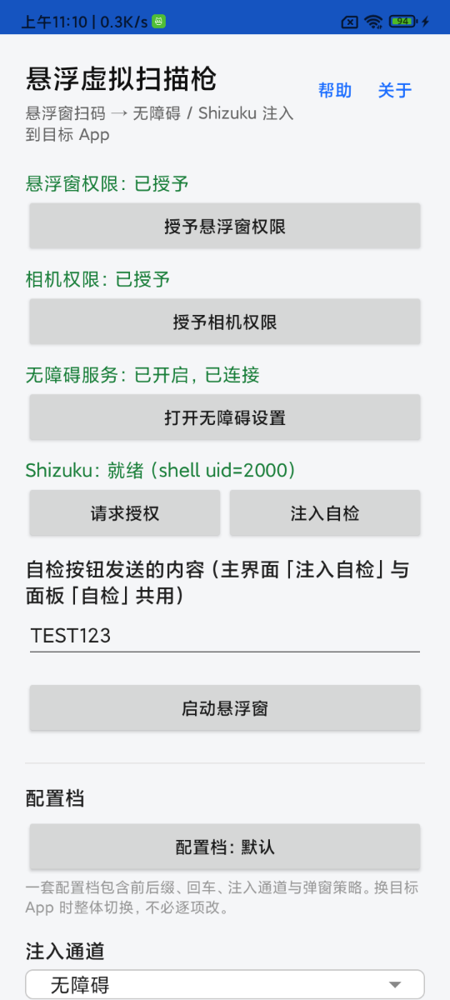
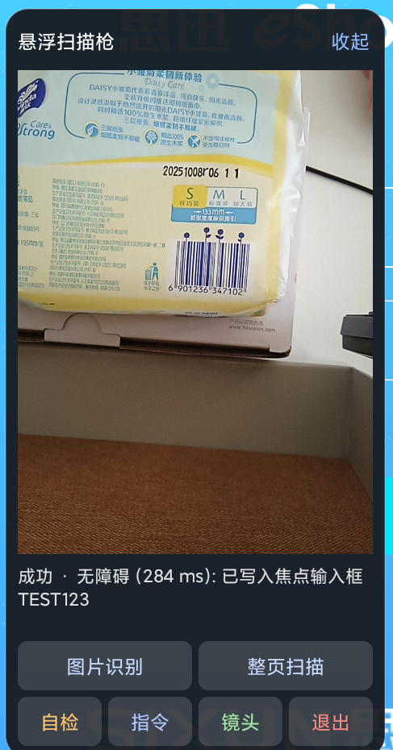
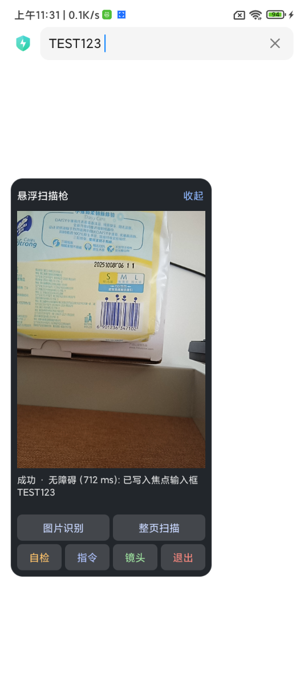

# 悬浮虚拟扫描枪（Floating Virtual Scanner Gun）

[简体中文] · [繁體中文](README_zh-TW.md) · [English](README_en.md)

把 Android 手机变成一把**虚拟扫描枪**：悬浮窗取景扫码，识别结果像键盘输入一样送进当前 App，目标系统**零改造**。

> 目标 App 以为有人在打字，其实是手机摄像头在扫码。

**项目地址：** https://github.com/ethanleellj/FloatingVirtualScannerGun

`Android 8.0+` · `0.2.0` · 界面支持简体中文 / 繁體中文 / English



## 解决什么问题

### 场景一：收银 / 仓储系统不能扫码

自助收银、WMS、ERP、门店 POS 等大量在用的业务系统只接受键盘输入，没有摄像头扫码。一线人员只能额外配一把硬件扫描枪——要买、要带、要充电、要管理。

这个 App 让手机顶替它：悬浮窗浮在业务系统之上，扫完立刻把条码"敲"进当前输入框，**全程不切 App、不改目标系统**。硬件扫描枪的习惯它也保留：前缀 / 后缀、自动回车、重复码过滤。



### 场景二：几十台设备要逐台抄序列号

盘点、入库、售后录入时，S/N、IMEI、MAC 要一个个抄进记事本或表格，慢且容易串行错位。

打开任意能打字的 App（备忘录、微信文件传输助手、Excel），把光标放进正文，勾上自动回车，再逐台扫——一条一行，原文照抄，导回电脑就能当表格用。一页纸印着几十个码时，用「整页扫描」拍一张，按阅读顺序一次录完（上限 100 条）。



## 三步上手

1. 安装后打开 App，按界面提示授予**悬浮窗 + 相机**权限，建议再开启无障碍服务（Shizuku 可选）
2. 点「**注入自检**」看到成功，切到目标 App 并把光标点进输入框
3. 点「**启动悬浮窗**」→ 点悬浮球展开面板 → 对准条码，成功后面板自动折回悬浮球

退出：面板「退出」或收起状态长按悬浮球 600 ms。详细用法在 App 右上角「帮助」。

## 功能现状

| 能力 | 说明 |
|---|---|
| 扫码 | CameraX 取景 + ML Kit 本机识别；连续 3 帧一致才录入，防手抖误读 |
| 注入通道 | 无障碍 → Shizuku 按键 → 剪贴板兜底，自动降级；另可切「网络转发」或「蓝牙键盘」给电脑用 |
| 录入方式 | 前缀 / 后缀（支持转义）、自动回车、追加 / 覆盖、重复码过滤、弹窗拦截 |
| 批量 | 整页扫描（拍照一次录完）、图库识别、9 档多码策略、常用指令、扫码历史（本地 500 条） |
| 便利 | 成功提示音、识别后自动折叠（可关）、悬浮球 / 面板位置记忆、配置档导入导出、三语界面、应用内帮助与项目说明 |
| 自动更新 | 每天检查一次 GitHub Releases，提示后下载安装；可在主界面关闭 |

## 主界面地图

| 分区 | 内容 |
|---|---|
| 顶部 | 权限状态 +「注入自检」+「启动悬浮窗」；右上角 [帮助] [关于] |
| 配置档 | 一套档打包前后缀、回车、通道、弹窗策略；可导入 / 导出 JSON |
| 扫码设置 | 通道、多码策略、码制、前缀后缀、自动回车、追加、去重、提示音、自动折叠 |
| 电脑输出 | 网络转发（地址 + 端口）或蓝牙键盘（选已配对的电脑） |
| 底部 | 常用指令、扫码历史、手动发送、摄像头、语言、启动时自动检查更新 |

## 配置项

| 常用项 | 默认值 | 什么时候改 |
|---|---|---|
| 自动回车 | 开 | 连续录入时保留；收银单码框按需关 |
| 追加 / 覆盖 | 追加 | 收银框只收一个码时切「覆盖全部」 |
| 识别后自动折叠 | 开 | 连续录入时关掉，面板保持展开 |
| 注入通道 | 自动 | 只收硬件按键的老 POS 可锁定 Shizuku；给电脑用切网络 / 蓝牙 |
| 多码同框策略 | 只取第一个 | 一页多码用「全部扫描（拍照整页）」 |
| 忽略重复条码 | 开 | 同一码需反复录入时关掉；同一码再录仍需先移开 1.2 s |
| 启动时自动检查更新 | 开 | 离线或不希望联网时关掉 |

前后缀支持 `\n` `\r` `\t` `\xNN` 转义，例如前缀 `PDA-` + 后缀 `\r`，发出去就是 `PDA-6901234567890` ⏎。

## 自动更新

- 默认每天首次启动时静默检查一次 GitHub Releases；也可在「关于 → 检查更新」手动查
- 有新版本时显示版本号与发布说明，由你确认后才下载 APK 并交给系统安装器
- 失败、无网络、暂无发布版本都不影响扫码；主界面可关闭自动检查
- 需要访问 GitHub；检查请求只包含版本查询，不上传扫码内容

## 给电脑当扫描枪

- **网络转发**：扫到的内容按行发到电脑上的 TCP 接收端（默认端口 9100），仓库自带 `tools/pc_receiver/receiver.py`；需手机和电脑在同一局域网，明文无鉴权，只用于可信内网
- **蓝牙键盘**：手机注册成 HID 键盘，电脑侧零安装；需 Android 9+、先由电脑发起配对，且内容只能是可打印 ASCII

两条通道都尚未做完整的端到端真机验证，上生产前请用真实电脑走一遍。

## 已知限制

- 无障碍通道要求目标 App 有标准输入框；完全没有输入框的 POS 只能走 Shizuku 或剪贴板
- 同一码再次录入需要先离开镜头至少 1.2 s；闪现一两帧的条码可能扫不到
- 弹窗检测是启发式：只拦带常见关闭按钮的对话框，没开无障碍时不拦
- 中文输入法下走 Shizuku 可能把标点变全角；有输入框时优先走无障碍
- 网络转发失败不重试；蓝牙键盘只认可打印 ASCII，且未做端到端验证
- 手机重启后需手动打开一次 App 拉起悬浮层；整页扫描单页上限 100 条
- 悬浮位置按屏幕像素保存；旋转、分屏或换设备后若坐标越界，会夹回可见范围，可能要重新拖到习惯位置；面板比悬浮球大，展开时也会按可见范围收敛位置
- 详细清单与验证记录见[需求规格说明书](docs/需求规格说明书.md)与 App 内「关于 → 项目说明」

## 开发者

需要 Android Studio、JDK 25、Gradle 9.4.1（minSdk 26 / targetSdk 36）：

```bash
./gradlew assembleDebug
adb install -r app/build/outputs/apk/debug/app-debug.apk
```

`tools/sim/` 可离线回放扫码时序、多码策略与悬浮位置收敛，装机前先跑一遍：

```bash
javac -d tools/sim/out app/src/main/java/com/virtualscanner/gun/{ScanGuard,BarcodePick,Versions,Position}.java \
  tools/sim/{PickSim,GuardSim,UpdateSim,PositionSim}.java
java -cp tools/sim/out PickSim && java -cp tools/sim/out GuardSim \
  && java -cp tools/sim/out UpdateSim && java -cp tools/sim/out PositionSim
```

## 文档与许可

- [需求规格说明书](docs/需求规格说明书.md) · [隐私政策](docs/隐私政策.md)
- [GitHub 仓库](https://github.com/ethanleellj/FloatingVirtualScannerGun)
- Apache License 2.0，Copyright 2026 ethanleellj；详见 [LICENSE](LICENSE)
