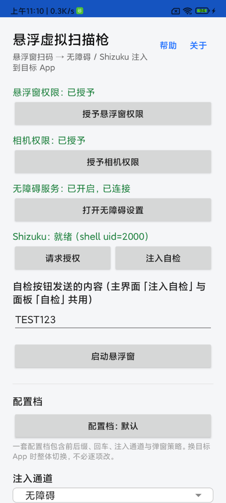
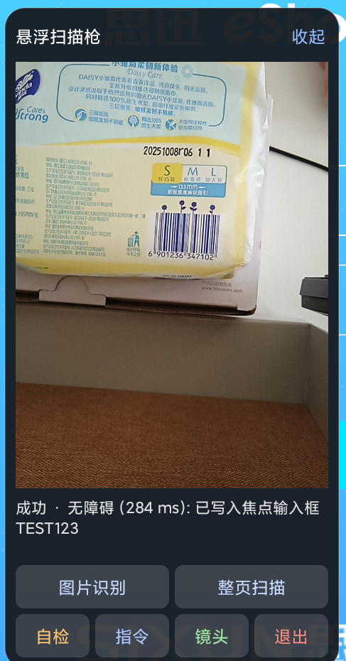
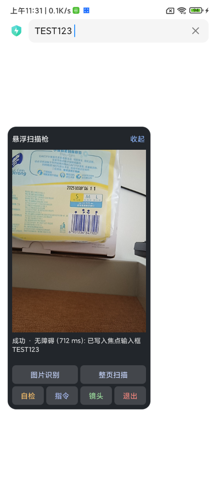

# Floating Virtual Scanner Gun

[简体中文](README.md) · [繁體中文](README_zh-TW.md) · [English]

Turn an Android phone into a **virtual scanner gun**: a floating window reads barcodes and types the result into whatever app currently has focus. The target system needs **no changes at all**.

> The target app thinks someone is typing. In fact, the phone camera is scanning.

**Project:** https://github.com/ethanleellj/FloatingVirtualScannerGun

`Android 8.0+` · `0.1-demo` · UI available in English / 简体中文 / 繁體中文



## What problem does it solve?

### 1. The POS / warehouse system cannot scan

Self-service checkouts, WMS, ERP and shop-floor POS systems often accept keyboard input only — there is no camera scanning. Staff end up carrying a separate hardware scanner: buy it, charge it, keep track of it.

This app replaces it. The floating panel sits on top of the business app and types the barcode straight into its focused field — **no app switching, no changes to the target app**. Familiar scanner behaviour is kept: prefix / suffix, auto-Enter and duplicate filtering.



### 2. Copying serial numbers one by one

During stocktaking, receiving or warranty registration, S/N, IMEI and MAC addresses have to be copied by hand into notes or spreadsheets — slow and easy to misalign.

Open any app that accepts text (Notes, a chat window, Excel), put the cursor in the body, turn on auto-Enter, then scan one item after another: one code per line, copied verbatim, ready to use as a table back on the PC. For a sheet with dozens of codes, **Scan page** photographs the sheet and types every code in reading order (100-code limit).



## Three steps

1. Install and open the app; grant **overlay + camera** permissions as prompted, and enable the accessibility service if possible (Shizuku is optional)
2. Tap **Injection self-test** and confirm success; switch to the target app and tap its input field
3. Tap **Start overlay** → tap the floating ball → point at a barcode; after a successful scan the panel folds back to the ball

To exit: **Exit** on the panel, or long-press the collapsed ball for 600 ms. The in-app **Help** button has the full walkthrough.

## Current features

| Area | What it does |
|---|---|
| Scanning | CameraX preview + on-device ML Kit; 3 consecutive identical frames required, so a shaky read cannot slip through |
| Injection | Accessibility → Shizuku key events → clipboard fallback, auto-degrading; network forwarding and Bluetooth HID can target a PC instead |
| Entry | Prefix / suffix (with escapes), auto-Enter, append / replace, duplicate filter, modal-dialog guard |
| Bulk | Whole-page scan, image picker, 9 multi-code policies, named snippets, local 500-entry history |
| Convenience | Success beep, fold panel after a successful scan (can be off), floating ball / panel position memory, profile import/export, three UI languages, offline help and project README |
| Updates | One GitHub Releases check per day, download and install only after confirmation; can be disabled |

## Main screen at a glance

| Area | Contents |
|---|---|
| Top | Permission status + **Injection self-test** + **Start overlay**; [Help] [About] at the top right |
| Profile | One profile bundles prefix/suffix, Enter, channel and dialog policy; import / export as JSON |
| Scan settings | Channel, multi-code policy, code types, prefix/suffix, auto-Enter, append, dedup, beep, auto-fold |
| PC output | Network forwarding (host + port) or Bluetooth keyboard (pick a paired computer) |
| Bottom | Snippets, scan history, manual send, camera, language, auto-check updates on startup |

## Settings

| Setting | Default | When to change it |
|---|---|---|
| Auto-Enter | On | Keep for batch entry; turn off for a single-code checkout field |
| Append / Replace | Append | Use Replace when the checkout field must hold only one code |
| Auto-fold after a scan | On | Turn off for continuous entry so the panel stays open |
| Injection channel | Auto | Lock Shizuku for old POS terminals that accept only key events; use network / Bluetooth for a PC |
| Multi-code policy | First detected | Use "Scan all (photo page)" for a sheet with many codes |
| Ignore duplicate codes | On | Turn off when the same code must be entered twice; the label still has to leave the frame for 1.2 s |
| Check updates on startup | On | Turn off when offline or when you do not want any network traffic |

Prefix and suffix support `\n` `\r` `\t` `\xNN` escapes: prefix `PDA-` plus suffix `\r` sends `PDA-6901234567890` ⏎.

## Automatic updates

- By default the app quietly checks GitHub Releases once a day on first launch; **About → Check for updates** does it manually
- When a newer version exists, you see the version and release notes; the APK is downloaded and handed to the system installer only after you confirm
- Network errors, missing releases and other failures never affect scanning; automatic checks can be switched off on the main screen
- Access to GitHub is required; the check only queries the version — scanned data is never uploaded

## Using the phone as a PC scanner

- **Network forwarding**: each scan is written as one line to a TCP receiver on the PC (port 9100 by default). A minimal receiver is included at `tools/pc_receiver/receiver.py`. The phone and PC must be on the same LAN. Traffic is plain text with no authentication — use it only on a trusted network.
- **Bluetooth keyboard**: the phone registers as an HID keyboard, so the PC needs no software. Requires Android 9+, pairing initiated by the PC, and printable ASCII content only.

Neither PC channel has been verified end-to-end on a real computer yet — test with your own PC before production use.

## Known limitations

- The accessibility channel needs a standard text field; POS apps with no input field at all must use Shizuku or the clipboard
- The same code has to leave the camera frame for at least 1.2 s before it can be entered again; a code visible for only one or two frames may be missed
- The dialog guard is heuristic: it only blocks dialogs with common dismiss buttons, and cannot judge anything if accessibility is off
- Under a Chinese IME, Shizuku key injection may convert punctuation to full-width forms; apps with an input field use accessibility first
- Network forwarding does not retry; the Bluetooth keyboard accepts printable ASCII only and has not been end-to-end tested
- After a phone restart, open the app once to bring back the overlay; a whole-page scan handles at most 100 codes
- The saved position is in screen pixels; after rotation, split-screen or a device change, an off-screen coordinate is clamped back into view and may need re-dragging. The panel is larger than the ball, so its position is clamped when expanded
- Full details and verification records: [requirements spec](docs/需求规格说明书.md) and **About → Project README** inside the app

## Developers

Android Studio, JDK 25 and Gradle 9.4.1 are required (minSdk 26 / targetSdk 36):

```bash
./gradlew assembleDebug
adb install -r app/build/outputs/apk/debug/app-debug.apk
```

`tools/sim/` replays scanning timing, multi-code logic and floating-position clamping without a device:

```bash
javac -d tools/sim/out app/src/main/java/com/virtualscanner/gun/{ScanGuard,BarcodePick,Versions,Position}.java \
  tools/sim/{PickSim,GuardSim,UpdateSim,PositionSim}.java
java -cp tools/sim/out PickSim && java -cp tools/sim/out GuardSim \
  && java -cp tools/sim/out UpdateSim && java -cp tools/sim/out PositionSim
```

## Docs and license

- [Requirements specification](docs/需求规格说明书.md) · [Privacy policy](docs/隐私政策.md)
- [GitHub repository](https://github.com/ethanleellj/FloatingVirtualScannerGun)
- Apache License 2.0, Copyright 2026 ethanleellj; see [LICENSE](LICENSE)
