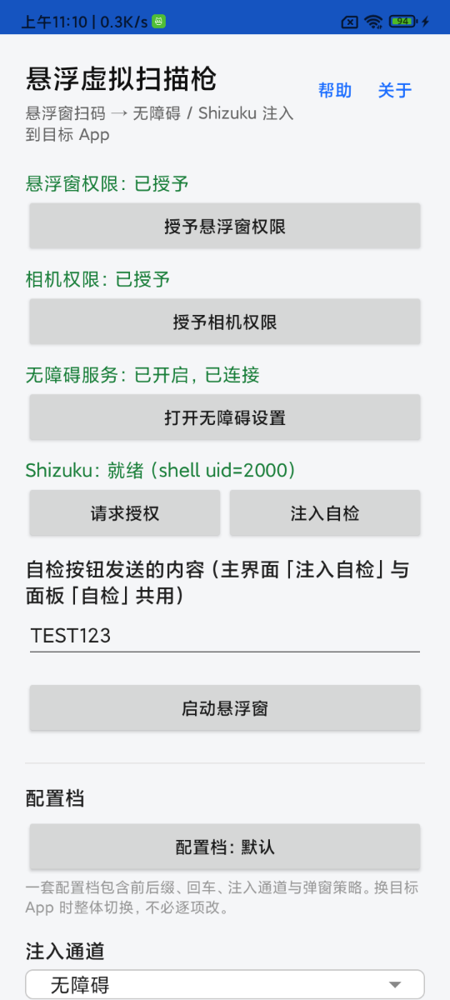
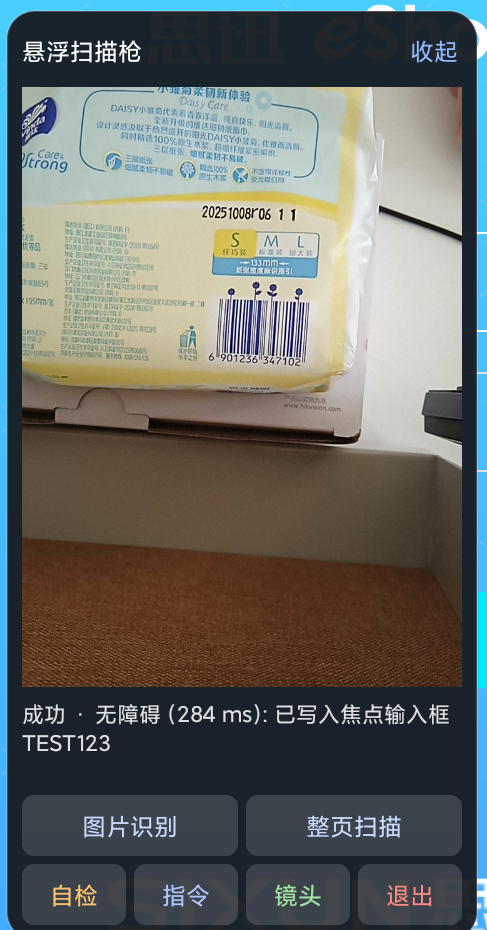
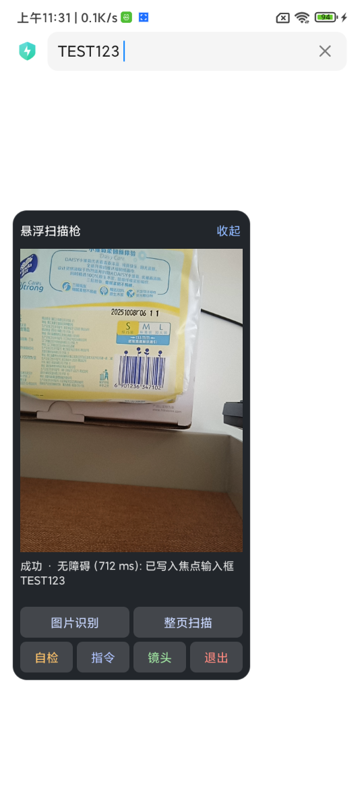

# 懸浮虛擬掃描槍（Floating Virtual Scanner Gun）

[简体中文](README.md) · [繁體中文] · [English](README_en.md)

把 Android 手機變成一把**虛擬掃描槍**：懸浮窗取景掃碼，識別結果像鍵盤輸入一樣送進目前的 App，目標系統**零改造**。

> 目標 App 以為有人在打字，其實是手機攝影機在掃碼。

**專案網址：** https://github.com/ethanleellj/FloatingVirtualScannerGun

`Android 8.0+` · `0.2.0` · 介面支援簡體中文 / 繁體中文 / English



## 解決什麼問題

### 情境一：收銀 / 倉儲系統不能掃碼

自助收銀、WMS、ERP、門市 POS 等大量在用的業務系統只接受鍵盤輸入，沒有攝影機掃碼。第一線人員只能額外配一把硬體掃描槍——要買、要帶、要充電、要管理。

這個 App 讓手機頂替它：懸浮窗浮在業務系統之上，掃完立刻把條碼「敲」進目前的輸入框，**全程不切 App、不改目標系統**。硬體掃描槍的習慣它也保留：前綴 / 後綴、自動 Enter、重複碼過濾。



### 情境二：幾十台設備要逐台抄序號

盤點、入庫、售後登錄時，S/N、IMEI、MAC 要一個個抄進記事本或試算表，慢且容易串行錯位。

打開任何能打字的 App（備忘錄、微信檔案傳輸助手、Excel），把游標放進本文，勾上自動 Enter，再逐台掃——一條一行，原文照抄，匯回電腦就能當表格用。一張 A4 印著幾十個碼時，用「整頁掃描」拍一張，按閱讀順序一次錄完（上限 100 條）。



## 三步上手

1. 安裝後開啟 App，依照畫面提示授予**懸浮窗 + 相機**權限，建議再開啟無障礙服務（Shizuku 可選）
2. 點「**注入自檢**」看到成功，切到目標 App 並把游標點進輸入框
3. 點「**啟動懸浮窗**」→ 點懸浮球展開面板 → 對準條碼，成功後面板自動收合回懸浮球

退出：面板「退出」或收合狀態長按懸浮球 600 ms。詳細用法在 App 右上角「說明」。

## 功能現況

| 能力 | 說明 |
|---|---|
| 掃碼 | CameraX 取景 + ML Kit 本機識別；連續 3 幀一致才錄入，防手抖誤讀 |
| 注入通道 | 無障礙 → Shizuku 按鍵 → 剪貼簿兜底，自動降級；另可切「網路轉發」或「藍牙鍵盤」給電腦用 |
| 錄入方式 | 前綴 / 後綴（支援轉義）、自動 Enter、追加 / 覆蓋、重複碼過濾、彈窗攔截 |
| 批次 | 整頁掃描（拍照一次錄完）、圖庫識別、9 檔多碼策略、常用指令、掃描紀錄（本機 500 條） |
| 便利 | 成功提示音、識別後自動收合（可關）、懸浮球 / 面板位置記憶、設定檔匯入匯出、三語介面、應用程式內說明與專案說明 |
| 自動更新 | 每天檢查一次 GitHub Releases，提示後下載安裝；可在主介面關閉 |

## 主介面地圖

| 區塊 | 內容 |
|---|---|
| 頂部 | 權限狀態 +「注入自檢」+「啟動懸浮窗」；右上角 [說明] [關於] |
| 設定檔 | 一套檔打包前後綴、Enter、通道、彈窗策略；可匯入 / 匯出 JSON |
| 掃碼設定 | 通道、多碼策略、碼制、前後綴、自動 Enter、追加、去重、提示音、自動收合 |
| 電腦輸出 | 網路轉發（位址 + 連接埠）或藍牙鍵盤（選已配對的電腦） |
| 底部 | 常用指令、掃描紀錄、手動傳送、攝影機、語言、啟動時自動檢查更新 |

## 設定項

| 常用項 | 預設值 | 什麼時候改 |
|---|---|---|
| 自動 Enter | 開 | 連續錄入時保留；收銀單碼框按需關 |
| 追加 / 覆蓋 | 追加 | 收銀框只收一個碼時切「覆蓋全部」 |
| 識別後自動收合 | 開 | 連續錄入時關掉，面板保持展開 |
| 注入通道 | 自動 | 只收硬體按鍵的老 POS 可鎖定 Shizuku；給電腦用切網路 / 藍牙 |
| 多碼同框策略 | 只取第一個 | 一頁多碼用「全部掃描（拍照整頁）」 |
| 忽略重複條碼 | 開 | 同一碼需反覆錄入時關掉；同一碼再錄仍需先移開 1.2 s |
| 啟動時自動檢查更新 | 開 | 離線或不希望連網時關掉 |

前後綴支援 `\n` `\r` `\t` `\xNN` 轉義，例如前綴 `PDA-` + 後綴 `\r`，送出去就是 `PDA-6901234567890` ⏎。

## 自動更新

- 預設每天首次啟動時靜默檢查一次 GitHub Releases；也可在「關於 → 檢查更新」手動查
- 有新版本時顯示版本號與發布說明，由你確認後才下載 APK 並交給系統安裝器
- 失敗、無網路、暫無發布版本都不影響掃碼；主介面可關閉自動檢查
- 需要能存取 GitHub；檢查請求只做版本查詢，不上傳掃描內容

## 給電腦當掃描槍

- **網路轉發**：掃到的內容按行發到電腦上的 TCP 接收端（預設連接埠 9100），專案附 `tools/pc_receiver/receiver.py`；需手機與電腦在同一區域網路，明文無驗證，僅用於可信內網
- **藍牙鍵盤**：手機註冊成 HID 鍵盤，電腦側零安裝；需 Android 9+、先由電腦發起配對，且內容只能是可列印 ASCII

兩條通道都尚未做完整的端到端真機驗證，上生產前請用真實電腦走一遍。

## 已知限制

- 無障礙通道要求目標 App 有標準輸入框；完全沒有輸入框的 POS 只能走 Shizuku 或剪貼簿
- 同一碼再次錄入需要先離開鏡頭至少 1.2 s；閃現一兩幀的條碼可能掃不到
- 彈窗檢測是啟發式：只攔帶常見關閉按鈕的對話框，沒開無障礙時不攔
- 中文輸入法下走 Shizuku 可能把標點變全形；有輸入框時優先走無障礙
- 網路轉發失敗不重試；藍牙鍵盤只認可列印 ASCII，且未做端到端驗證
- 手機重開機後需手動開啟一次 App 拉起懸浮層；整頁掃描單頁上限 100 條
- 懸浮位置以螢幕像素儲存；旋轉、分割畫面或換裝置後若座標越界，會夾回可見範圍，可能要重新拖到習慣的位置；面板比懸浮球大，展開時也會依可見範圍收斂位置
- 詳細清單與驗證紀錄見[需求規格說明書](docs/需求规格说明书.md)與 App 內「關於 → 專案說明」

## 開發者

需要 Android Studio、JDK 25、Gradle 9.4.1（minSdk 26 / targetSdk 36）：

```bash
./gradlew assembleDebug
adb install -r app/build/outputs/apk/debug/app-debug.apk
```

`tools/sim/` 可離線回放掃碼時序、多碼策略與懸浮位置收斂，裝機前先跑一遍：

```bash
javac -d tools/sim/out app/src/main/java/com/virtualscanner/gun/{ScanGuard,BarcodePick,Versions,Position}.java \
  tools/sim/{PickSim,GuardSim,UpdateSim,PositionSim}.java
java -cp tools/sim/out PickSim && java -cp tools/sim/out GuardSim \
  && java -cp tools/sim/out UpdateSim && java -cp tools/sim/out PositionSim
```

## 文件與授權

- [需求規格說明書](docs/需求规格说明书.md) · [隱私政策](docs/隐私政策.md)
- [GitHub 專案](https://github.com/ethanleellj/FloatingVirtualScannerGun)
- Apache License 2.0，Copyright 2026 ethanleellj；詳見 [LICENSE](LICENSE)
